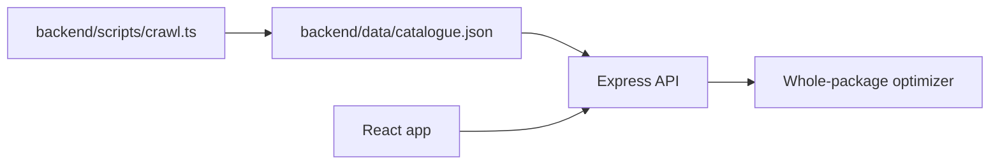

# Design

## Architecture overview

The crawler is a scheduled data-ingestion step. It writes validated Al-Fatah listings to `backend/data/catalogue.json`. The API and optimizer read that local snapshot, so shopper requests remain fast and do not depend on store availability.

## Components

| Component | Responsibility | Technology |
|-----------|----------------|------------|
| Store crawler | Fetch public structured product data from Al-Fatah | Node, fetch, Cheerio |
| Snapshot loader | Validate and normalize local JSON | TypeScript, Zod |
| Optimizer | Select valid whole-package combinations | TypeScript |
| HTTP API | Expose health, catalogue, and optimization endpoints | Express |

## Data model

`Listing` records store, product, brand, normalized quantity/unit, price, URL, availability, snapshot time, and source. Supported units are grams, millilitres, and pieces. The snapshot also records store delivery fees and minimum order values.

## API / interfaces

| Method | Endpoint / interface | Purpose | Auth required |
|--------|----------------------|---------|---------------|
| GET | `/api/health` | Health check | No |
| GET | `/api/catalogue` | Return the validated two-store snapshot | No |
| POST | `/api/optimize` | Calculate a valid basket for item text, budget, and exclusions | No |

## Key decisions and tradeoffs

| Decision | Options considered | Chosen | Why | Tradeoff accepted |
|----------|--------------------|--------|-----|-------------------|
| Periodic snapshot instead of request-time crawling | Live request crawl, database, local JSON | Local JSON snapshot | Fast and deterministic for judging | Data can become stale |
| Structured feed instead of HTML scraping | Live HTML parsing | Al-Fatah Shopify products JSON | Stable product and price fields | Coverage depends on public feed |
| Code validates prices and quantities | AI-generated basket math | Deterministic optimizer | Prevents incorrect affordability claims | More implementation work |

## AI components

<!-- What AI does in the product, what code validates, and what happens when AI fails. -->

## Security and privacy

### Threat model

### Data handled

### Known limits

- The crawler currently extracts Al-Fatah Shopify product records and requires `ALFATAH_CATALOGUE_URL` to be configured.
- Store-specific selectors, locations, and delivery rules may need adjustment after inspecting the live sites.
- The fallback catalogue remains a dated demonstration snapshot until a successful crawl replaces it.
