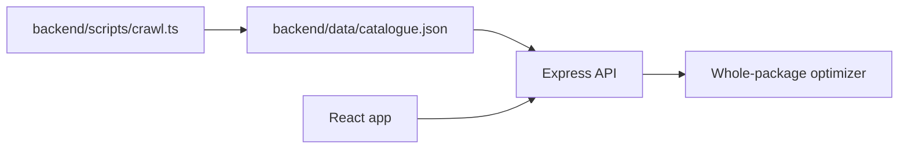

# Design

## Architecture overview

The crawler is a scheduled data-ingestion step. It writes validated Al-Fatah listings to `backend/data/catalogue.json`. The API and optimizer read that local snapshot, so shopper requests remain fast and do not depend on store availability.

## Components

| Component | Responsibility | Technology |
|-----------|----------------|------------|
| Store crawler | Fetch public structured product data from Al-Fatah | Node, fetch, Cheerio |
| Snapshot loader | Validate and normalize local JSON | TypeScript, Zod |
| Optimizer | Select valid whole-package combinations | TypeScript |
| HTTP API | Expose health, catalogue, and optimization endpoints | Express |

## Data model

`Listing` records store, product, brand, normalized quantity/unit, price, URL, availability, snapshot time, and source. Supported units are grams, millilitres, and pieces. The snapshot also records store delivery fees and minimum order values.

## API / interfaces

| Method | Endpoint / interface | Purpose | Auth required |
|--------|----------------------|---------|---------------|
| GET | `/api/health` | Health check | No |
| GET | `/api/catalogue` | Return the validated two-store snapshot | No |
| POST | `/api/optimize` | Calculate a valid basket for item text, budget, and exclusions | No |

## Key decisions and tradeoffs

| Decision | Options considered | Chosen | Why | Tradeoff accepted |
|----------|--------------------|--------|-----|-------------------|
| Periodic snapshot instead of request-time crawling | Live request crawl, database, local JSON | Local JSON snapshot | Fast and deterministic for judging | Data can become stale |
| Structured feed instead of HTML scraping | Live HTML parsing | Al-Fatah Shopify products JSON | Stable product and price fields | Coverage depends on public feed |
| Code validates prices and quantities | AI-generated basket math | Deterministic optimizer | Prevents incorrect affordability claims | More implementation work |

## AI components

AI is used during development to help draft and refine the crawler, parser, optimizer, frontend, tests, and documentation. At runtime, the product does not make an unvalidated AI affordability decision: the frontend sends plain item text to the API, deterministic TypeScript parsing normalizes quantities and aliases, and the optimizer enumerates valid whole-package combinations.

The runtime pipeline is:

1. Parse English, Urdu terms, and Roman Urdu aliases into canonical grocery queries.
2. Validate catalogue data with Zod before it enters the optimizer.
3. Filter unavailable or excluded-brand listings.
4. Select combinations that satisfy requested quantities and store minimums.
5. Add delivery fees and classify the result as within budget, over budget, or no valid basket.

If parsing or matching fails, the API returns an explicit error or `no_valid_basket` result with warnings. It does not silently substitute an unrelated product.

## Security and privacy

### Threat model

- Untrusted browser input can reach the optimization endpoint, so request bodies are validated with Zod.
- Catalogue files and crawler responses are treated as untrusted data and validated before use.
- Product URLs and image URLs originate from the catalogue snapshot and are opened in a new tab with `rel="noreferrer"`.
- The application has no accounts, payment processing, or private user data.

### Data handled

- Grocery item text, optional budget, and optional excluded-brand text submitted for one optimization request.
- Cached public catalogue fields: product names, brands, prices, package sizes, availability, source URLs, and image URLs.
- No passwords, payment data, authentication tokens, or persistent shopper profiles.

### Known limits

- The crawler currently extracts Al-Fatah Shopify product records and requires `ALFATAH_CATALOGUE_URL` to be configured.
- Store-specific selectors, locations, and delivery rules may need adjustment after inspecting live sites.
- The fallback catalogue remains a dated demonstration snapshot until a successful crawl replaces it.
- CORS is intentionally open for the local demo and should be restricted before production deployment.
