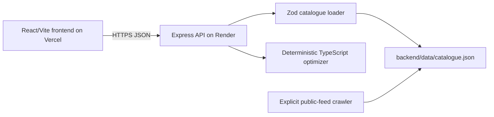

# Bachat Basket: Product Overview

## What the product is

Bachat Basket is a grocery basket optimizer for budget-conscious shoppers in
Pakistan. A shopper enters a list such as `2 kg rice, 1 litre oil, eggs`, an
optional budget, and optional brand exclusions. The product returns a complete
basket using whole packages, rather than comparing isolated item prices.

The recommendation includes selected products, quantities, product links,
images when available, store subtotals, delivery fees, minimum-order checks,
the total price, and an explicit result status:

- **Within budget** — the basket total is at or below the requested budget.
- **Over budget** — a valid basket exists, but its total exceeds the budget.
- **No valid basket** — no available catalogue combination satisfies the
  request and store rules.

No account, checkout, payment, or personal profile is required. The current
live catalogue is based on a validated Al-Fatah live prices. Metro is shown as a
comparison reference, not as a live crawled source(api needed).

## What it does

1. Accepts grocery names and quantities in English, Urdu terms, and Roman Urdu
   aliases.
2. Normalizes quantities into supported units: grams, millilitres, and pieces.
3. Matches requests against the validated catalogue and removes unavailable or
   excluded-brand listings.
4. Selects complete packages, so the result does not under-purchase the
   requested quantity.
5. Enumerates valid product combinations and chooses the lowest-cost result
   while applying store minimum orders and delivery charges.
6. Presents the recommendation and catalogue in a browser-friendly React UI.

Prices, availability, delivery fees, and minimum orders are snapshot data.
They should be confirmed with the store before placing an order.

## Architecture

| Layer | Deployment / technology | Responsibility |
|---|---|---|
| Frontend | Vercel free, React, Vite | Collects requests and renders baskets and catalogue cards |
| API | Render free, Node.js, Express, TypeScript | Validates requests and exposes health, catalogue, and optimization endpoints |
| Catalogue | Versioned local JSON snapshot | Supplies validated public product, price, availability, and store-rule data |
| Optimizer | Runs in the API process | Matches items and calculates whole-package combinations deterministically |
| Crawler | Explicit Node command, not request-time | Refreshes the snapshot from publicly accessible structured data |

The API is stateless. It has no database, user accounts, background queue, or
request-time store crawl. This keeps normal optimization requests fast and
repeatable, but it also means that all users share the same catalogue snapshot
and that a crawler refresh is a deployment/maintenance operation.

## Capacity estimate for the free-tier deployment

This is a planning estimate, not a measured SLA or a provider guarantee. No
load test has been run against the public deployment. The main constraint is
the single free Render web service, not Vercel: the frontend is static and can
serve many browser sessions, while optimization work, memory, cold starts,
monthly free-tier hours, and provider throttling are concentrated on one API
instance.

For the current small catalogue and ordinary requests of roughly 1–8 grocery
items, the recommended planning target is:

| Usage measure | Conservative target | Interpretation |
|---|---:|---|
| Simultaneous browsing sessions | 50–100 | Users can load the Vercel UI; only a subset is expected to call the API at the same instant |
| Simultaneous optimization requests | 10–20 | A practical warm-instance target, not a guaranteed hard limit |
| Daily active users | 100–300 | Assumes approximately five optimization requests per active user |
| Monthly active users | 3,000–9,000 | A simple 30-day projection of the daily estimate |

These figures assume normal interactive traffic, a small request body, the
current catalogue size, and no unusually large or adversarial optimization
request. They should be reduced if users submit many items at once or if the
free Render service is sleeping and handling cold starts. Vercel bandwidth,
Render free-tier hours, instance memory/CPU, and any provider rate limits can
change; the deployed provider dashboards are the source of truth.

For a public launch, capacity should be confirmed with a load test using
production-like requests. If demand exceeds this planning range, the next
steps are request rate limiting and input caps, a persistent/shared catalogue
store, caching, metrics, and a paid or horizontally scalable API deployment.

## Current limitations

- Only Al-Fatah is currently crawled and supported as a live source.
- Catalogue information can become stale between snapshot refreshes.
- Delivery rules may vary by city or order context.
- The service does not place orders or reserve inventory.
- The free-tier deployment should not be treated as an availability,
  latency, or concurrency SLA.

